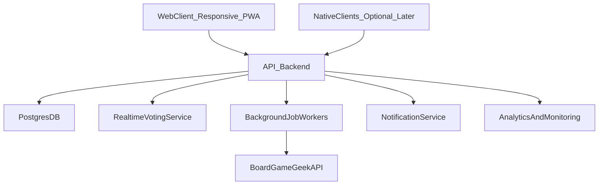

# Build Plan: Board Game Night App (Full V1)

## Product Goal

Ship a web-first, mobile-responsive app where groups can plan game nights, discover the best game for attendees, vote on options, and improve future recommendations from past sessions.

## Core Feature Scope (V1)

- Authentication and profiles
  - Email/password + social login (Google/Apple)
  - BoardGameGeek account linking (username-based), not BGG SSO
  - Optional BGG profile verification flow (proof token in profile/bio and one-time check)
  - Player profile: display name, avatar, location/timezone, preferred play length/weight
- Personal game library
  - Manual game add/edit/remove
  - BoardGameGeek import/sync (owned games, metadata)
  - Assisted shelf-scan import from photos (OCR + candidate matching + user confirmation)
  - Per-user ratings and play history notes
- Events and attendance
  - Create private invite-only events and public/open events
  - Guest RSVP/voting via secure invite links before full signup
  - RSVP states: going/maybe/not going
  - Capacity, date/time, location (or online), host controls
- Recommendation engine
  - Candidate games based on attendee ownership
  - Optional discovery mode to include games not owned by attendees
  - Filter by player count compatibility, estimated playtime, complexity
  - Label candidate source (owned by attendee, host-owned, external suggestion)
  - Score with weighted factors: attendee ratings, completion history, and recency
  - Explainability labels for each recommendation (why it was suggested)
- Voting/ranking
  - Event participants rank games (most-to-least preferred)
  - Aggregate with ranked-choice style scoring (e.g., Borda count) + tie-break rules
  - Decision deadline and auto-close voting to reduce indecision
  - Host can lock selected game
- Post-event feedback loop
  - Quick survey for attendees: enjoyment rating + did you finish at least one game?
  - Persist outcomes and feed recommendation weights for future events
  - V1 session timer logging with two taps (`Start night` / `End night`) to capture total duration
  - Optional manual time fix fallback when host forgets to start/end

## Suggested Additional Features (High Value)

- Calendar integration (Google/Apple calendar sync)
- Smart reminders (RSVP reminders, bring-this-game reminders)
- Availability polling before creating event date
- In-app chat/thread per event
- "What should we play tonight?" quick mode for last-minute sessions
- Discovery sources for external suggestions (BGG hotness/trending, similar-to-liked games, curated local picks)
- Friends graph and trust weighting (prioritize close-group preferences)
- Host tools: randomizer mode, fallback game, waitlist handling, reusable event templates
- Safety/reporting for open events + moderation controls
- Achievement/stats dashboard (games played, completion rate, favorite genres)
- Bring/acquire planning for non-owned recommendations (who can borrow, buy, or bring)
- Group memory cards before each event (recently loved games, completion stats)
- Camera-assisted physical collection import with box/title detection and quick review
- In-session timer with phase tracking and post-session duration quality feedback

## Technical Architecture

- Frontend client (V1): web app with mobile-first responsive UI + PWA support
- Native clients (later): optional React Native apps reusing backend/domain APIs
- Backend: Node.js (NestJS or Express) + PostgreSQL
- Realtime + async: WebSockets for live voting, background jobs for BGG sync and reminders
- Auth/session: JWT with refresh tokens, secure storage on device
- BGG integration boundary: app backend owns BGG API token and performs server-side requests
- Infrastructure: containerized API, managed Postgres, object storage for avatars
- Analytics/observability: product events + error tracking + audit logs for event actions

## Data Model (Initial)

- `users`, `friendships`
- `games`, `user_game_ownership`, `user_game_ratings`
- `events`, `event_attendees`, `event_invites`
- `events` stores canonical UTC start time plus `event_timezone` for consistent local rendering
- `event_game_candidates`, `event_votes`, `event_selected_game`
- `event_feedback` (enjoyment, finished_game, notes)
- `session_timings` (historical game-level timing samples) + event-level V1 timer fields (started_at, ended_at, total_minutes, source)
- `sync_accounts` (BoardGameGeek linkage and sync metadata)
- `bgg_verification_challenges` (challenge token, status, expiry, verified_at)

## Recommendation Strategy (V1)

- Build candidate set from games owned by attendees
- Optionally expand candidate set with external discovery suggestions when owned pool is too small or host enables it
- Exclude games incompatible with attendee count or constraints
- Score each game using:
  - attendee average rating (weighted by RSVP certainty)
  - historical completion rate in similar group size
  - time-fit score based on learned real session durations vs event time budget
  - freshness penalty (avoid repeating too often)
  - host preference boost (optional)
- Return top N with explanation labels ("fits 5 players", "high group rating", "not owned by attendees")

## Delivery Phases

1. Foundation: auth, profiles, schema, web navigation, CI/CD, 60-second host onboarding
2. Game libraries + BGG linking verification + sync integration
3. Event creation/invites/RSVP + guest flow + open event discovery
4. Recommendations + explainability labels + voting/ranking flow
5. Post-event feedback and recommendation feedback loop
6. Hardening: notifications, analytics, moderation, performance
7. Monetization rollout: subscriptions, paywall experiments, affiliate integration
8. Go-to-market rollout: beta cohorts, community launch, partnership scaling
9. Shelf-scan rollout: assisted import MVP, confidence scoring, and model tuning
10. Session intelligence rollout: timer UX, duration-learning model, and time-fit recommendation tuning
11. Native expansion gate: evaluate iOS/Android app build after web retention and conversion targets are sustained

## Execution Status Snapshot (Mar 2026)

- Must ship next
  - Apple social login parity (Google implemented)
  - Live provider expansion beyond webhook-only notifications (email/push channels)
  - Closed-beta validation with real groups and tracked retention metrics
  - Guest vote UX polish (identity continuity and invite-link vote edits)
- Next bets after stability
  - Monetization experiments (soft limits, trial prompts, affiliate link placement)
  - Go-to-market pilots with beta cohorts and referral loops
  - Shelf-scan assisted import MVP and model quality tuning
  - Session intelligence iteration (timer UX + learned duration fit)

## UX Simplification and Retention Priorities

- First-success UX
  - 60-second first event creation with smart defaults
  - Invitees can RSVP and vote without forced upfront registration
- Decision UX
  - Auto-generated shortlist of top game candidates
  - Recommendation explainability chips (player-fit, rating-fit, duration-fit, ownership source)
  - Voting deadline with automatic close and transparent tie-break handling
- Repeat-usage UX
  - Host event templates and one-tap repeat event creation
  - Group memory cards showing what worked in recent sessions
  - 2-tap post-event feedback prompt for higher completion
  - One-tap in-session timer start/stop with optional phase markers
- Reliability UX
  - Notification delivery guarantees and reminder retries
  - Deep links for calendar/map to reduce context switching

## Monetization Strategy

- Primary model: freemium + subscriptions
  - Free: core event planning, invites, RSVP, basic voting
  - Pro Individual: advanced recommendations, deeper analytics/history, unlimited groups/events
  - Pro Host: host automation features that benefit all attendees in host-created events
- Secondary model: affiliate links for suggested games and accessories
  - Add buy/compare links for recommended games
  - Track click-through and conversion by recommendation source
- Tertiary model (later): sponsored discovery placements
  - Clearly labeled sponsored content
  - Never override relevance ranking for core recommendations

## Monetization Rollout Plan

1. V1 (no hard paywall): launch free core + usage analytics to identify value moments
2. V1.5: introduce Pro tiers with soft limits and trial prompts at high-intent points
3. V2: add affiliate commerce layer and optimize recommendation-to-purchase funnels
4. V2+: experiment with sponsored placements and venue/store partnerships

## Monetization Metrics

- Free-to-paid conversion rate
- Subscription churn (30/60/90-day)
- ARPU and LTV/CAC (once paid acquisition starts)
- Recommendation click-through and acceptance rate
- Affiliate click and purchase conversion
- Event creation frequency and retained organizers (host retention)

## Go-To-Market Strategy

- Positioning
  - Primary message: reduce game-night decision friction (from chat chaos to quick consensus)
  - ICP (initial): recurring hosts/organizers of private friend groups
- Acquisition channels (priority order)
  - Community-led: BGG guilds/forums, Reddit, Discord, Facebook groups
  - Local ecosystem: board game cafes, stores, clubs, university groups
  - Creator/influencer demos: short walkthroughs of scheduling + recommendation + voting
  - Light paid tests only after retention baselines are healthy
- Growth loop
  - Host creates event -> invites attendees -> attendees onboard to vote -> some attendees become hosts
  - Optimize invite acceptance and first-vote completion as activation levers

## Go-To-Market Rollout Plan

1. Pre-launch (4-6 weeks)
  - Landing page + waitlist by city/group type
  - Recruit design partners (10-20 hosts) for concierge onboarding
2. Closed beta (6-8 weeks)
  - Run live pilots with real groups
  - Collect qualitative feedback after each event and iterate core recommendation/voting UX
3. Public launch
  - Coordinated posts in niche communities, launch content, and referral kickoff
  - Partner with local cafes/stores for hosted events
4. Scale phase
  - Expand partnerships, repeatable creator program, and selective paid acquisition
  - Trigger native app investment only after web retention and conversion milestones are met

## Go-To-Market Metrics

- Activation: % users joining/creating an event within 24 hours
- Host activation: % hosts creating first event within 7 days
- Invitation funnel: invites sent per host and invite acceptance rate
- Engagement: vote participation rate and recommendation acceptance rate
- Retention: week-4 host retention and month-2 group retention
- Growth efficiency: referral share of new active users and CAC payback window

## Shelf-Scan Import Strategy

- Product scope (initial)
  - Users capture 1-3 shelf photos and receive candidate game matches
  - System proposes top matches per detected title and asks for quick confirmation
  - Batch-add confirmed games into user collection
- Technical approach
  - OCR/title extraction from shelf images
  - Fuzzy matching against BGG catalog metadata
  - Confidence scoring with review states: auto-suggest, needs-review, rejected
- UX guardrails
  - Present confidence and source cues to build trust
  - Manual crop/edit flow for difficult spines/angles/glare
  - Never auto-add low-confidence items without user confirmation
- Rollout approach
  - V1.5 beta behind feature flag for selected users/hosts
  - Collect correction feedback and use it to improve matching quality
- Success metrics
  - Precision@1 for top suggestion
  - % items confirmed without manual search
  - Average time saved vs manual collection entry
  - False positive rate and user correction rate

## Quality and Validation

- Unit tests for ranking/recommendation scoring
- Integration tests for RSVP/voting/feedback workflows
- End-to-end web tests for critical journeys
- Beta with 2-3 real playgroups, measure:
  - event creation success rate
  - RSVP completion rate
  - vote participation rate
  - recommendation acceptance rate
  - post-event survey completion rate

## Architecture Overview

## Risks and Mitigations

- BoardGameGeek API limits/format changes -> cache responses, retry strategy, manual import fallback
- No official BGG social login path -> use account linking UX and verification challenge fallback
- Cold-start recommendation quality -> transparent scoring + manual override + collect early feedback aggressively
- Voting fairness disputes -> clear rules, visible ranking method, host override with audit trail
- Open-event safety concerns -> privacy controls, reporting/blocking, moderation queue

